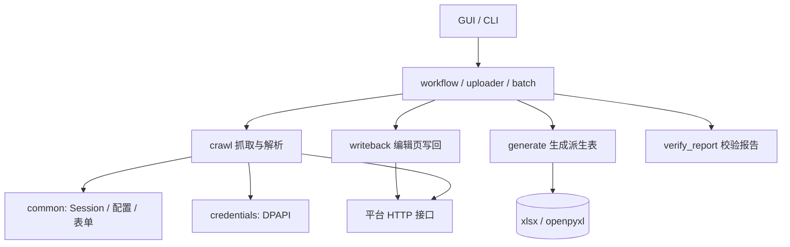

# CCTV 管道检测报告工具

面向城镇排水管道 CCTV 检测成果的自动化工具：登录平台 → 抓取五张报表 → 交叉校验 → 由 4126/4127 生成 4122/4123/4125 → 对比平台现状 → 选择性写回。

> 这是一个面向特定 JSP 业务平台的内部工具，包含平台地址与页面结构适配。建议使用 **Private** 仓库；公开前请先移除内网地址、账号信息与业务数据。


---

## 目录

- [功能特性](#功能特性)
- [五张报表](#五张报表)
- [架构与数据流](#架构与数据流)
- [快速开始](#快速开始)
- [图形界面](#图形界面)
- [命令行](#命令行)
- [配置与账号安全](#配置与账号安全)
- [依赖](#依赖)
- [打包 exe](#打包-exe)
- [测试](#测试)
- [目录结构](#目录结构)
- [已知限制](#已知限制)
- [文档](#文档)
- [许可与声明](#许可与声明)

---

## 功能特性

| 能力 | 说明 |
|---|---|
| 五表抓取 | 4122/4123/4125/4126/4127，自动翻页、去重、过滤表头/占位行/越界空壳页 |
| 交叉校验 | G1–G9：段数、重复、流向、缺陷数、长度、说明文字对账 |
| 派生表生成 | 由 4126+4127 生成 4122 工程量表、4123 缺陷汇总表、4125 缺陷数量统计表 |
| 差异对比 | 平台现状 vs 生成结果，逐字段/逐段比较，一致自动跳过 |
| 选择性写回 | 4122/4123/4125/4126/4127 按需写回；支持 `--dry` 演练 |
| 图形界面 | Tkinter：报告编号、输出目录、一键流程、上传勾选、批量、校验报告 |
| 命令行 | `cctv.py` 覆盖抓取、校验、生成、对比、写回、批量、自检 |
| 校验报告 | 生成含结论/明细/问题/文件清单的 xlsx |
| 账号安全 | Windows DPAPI 加密保存密码；配置文件不进仓库 |
| 离线自检 | `selftest` 覆盖解析器与校验器，不联网 |

## 五张报表

| 表号 | 名称 | 版式 | 用途 |
|---|---|---|---|
| 4122 | 主要工程量表 | 说明 + 表头 + 明细 + 总计，10 行/页 | 按管段类型/材质/管径汇总长度 |
| 4123 | 管道缺陷汇总一览表 | 说明 + 表头 + 12 行/页 | 每段管道的结构/功能缺陷描述 |
| 4125 | 管道缺陷数量统计表 | 单页 16 个缺陷行 + 合计 | 16 类缺陷按 1–4 级计数 |
| 4126 | 管段状况评估表 | 21 列 × 13 行/页 | 管段评估结论与指数 |
| 4127 | 管段检测与评估成果表 | 卡片式，1 管段/页 | 检测明细、4 个缺陷槽位、图片 |

> 4122 是“工程量”，4125 是“缺陷数量统计”，两者不要混淆。

## 架构与数据流



一次完整流程：


## 快速开始

### 方式一：源码运行（推荐开发）

要求：Windows + Python 3.10+。

```bash
git clone <本仓库地址>
cd cctv-report-tool
python -m pip install -r requirements.txt
python cctv_gui.py
```

首次启动会弹“平台账号”窗口；也可以命令行保存：

```bash
python cctv.py login --user 你的账号 --pwd 你的密码 --test
```

### 方式二：直接使用 exe

1. 从本仓库 **Releases** 下载便携包（如 `CCTV报告工具_便携版_*.zip`）；
2. 解压到桌面或 D 盘等可写目录；
3. 双击 `CCTV报告工具\CCTV报告工具.exe`。

> 必须保留 `_internal` 文件夹，不能只拷 exe。首次运行填写账号即可。

## 图形界面

```bash
python cctv_gui.py
```

| 按钮 | 作用 |
|---|---|
| 一键全流程 | 抓取五表 → 校验 → 生成 → 对比（不上传） |
| 全流程+上传 | 同上，并把有差异的 4122/4123/4125 写回（二次确认） |
| 只抓取 | 只抓五张表 |
| 只生成 4122/4123/4125 | 用目录里最新 4126/4127 生成三张派生表 |
| 校验报告 | 生成 `校验报告-<编号>-<时间>.xlsx` |
| 上传勾选 | 只上传下方勾选的表，平台已是目标值的自动跳过 |
| 批量… | 读报告编号列表（一行一个），逐个跑 |
| 账号 | 修改平台地址/账号/密码 |

输出默认在 exe/源码目录的 `输出/`。

## 命令行

```bash
# 抓全部表
python cctv.py crawl --bgbh 26KHD00029 --out-dir 输出

# 一键全流程（不上传 / 上传 / 演练）
python cctv.py workflow --bgbh 26KHD00029 --out-dir 输出 --no-upload
python cctv.py workflow --bgbh 26KHD00029 --out-dir 输出 --yes
python cctv.py workflow --bgbh 26KHD00029 --out-dir 输出 --dry

# 选择性上传（先 dry 看计划）
python cctv.py upload-tables --bgbh 26KHD00029 --out-dir 输出 \
    --tables 4122,4123,4125 --dry

# 生成 / 对比 / 按 Excel 写回
python cctv.py generate --bgbh 26KHD00029 --xlsx 对比标注.xlsx --out-dir 输出
python cctv.py diff     --bgbh 26KHD00029 --xlsx 对比标注.xlsx
python cctv.py upload   --bgbh 26KHD00029 --xlsx 对比标注.xlsx --dry

# 校验报告 / 离线校验 / 自检
python cctv.py verify-report --bgbh 26KHD00029 --out-dir 输出
python cctv.py verify        --bgbh 26KHD00029 --out-dir 输出
python cctv.py selftest
```

不带参数运行 `python cctv.py` 会进入交互菜单（全流程 / 只抓取 / 只校验 / 生成 / 批量）。

## 配置与账号安全

配置查找顺序（从高到低）：

1. 环境变量 `CCTV_CONFIG` 指定的文件；
2. `%APPDATA%\CCTV工具\cctv_config.json`（exe 正常安装）；
3. exe 同目录 `cctv_config.json`（便携版）；
4. `~/.cctv/cctv_config.json`；
5. 内置 `DEFAULTS`（平台地址、IGID）。

账号也可用环境变量：`CCTV_USER` / `CCTV_PWD` / `CCTV_BASE` / `CCTV_IGID`。

- 密码使用 **Windows DPAPI** 加密（`pwd_enc`），只有同一 Windows 用户能解密；
- `cctv_config.json`、`config.py`、`*.xlsx`、`*.pdf`、输出目录、exe/`_internal` 均已加入 `.gitignore`；
- **不要把真实账号、密码、报告数据或内网地址提交到公开仓库**。

## 依赖

运行依赖见 [`requirements.txt`](requirements.txt)：

```text
openpyxl==3.1.5
```

- GUI：Python 标准库 `tkinter`（Windows 版 Python 自带，PyInstaller 会带 Tcl/Tk 8.6）；
- 网络：标准库 `urllib` + `http.cookiejar`；
- 加密：Windows `crypt32` DPAPI（`ctypes`）；
- 打包：`pyinstaller==6.22.3`（见 [`requirements-dev.txt`](requirements-dev.txt)）。

无需浏览器、无需 Selenium/Playwright（`locate_via_browser` 只是旧版可选兜底）。

## 打包 exe

```bash
python -m pip install -r requirements-dev.txt
python _build/build_exe.py            # onedir（推荐）
python _build/build_exe.py --onefile  # 单文件（可选）
```

产物在 `dist/onedir/`：

```text
dist/onedir/CCTV报告工具/CCTV报告工具.exe
dist/onedir/CCTV命令行/CCTV命令行.exe
```

`_build/build_exe.py` 针对 Windows + Anaconda 环境显式收集了 `_tkinter.pyd`、`pyexpat.pyd`、`tcl86t.dll`、`tk86t.dll`、`tcl8.6`/`tk8.6` 数据；换环境时按需调整脚本顶部的 `BINARIES` / `DATAS`。

发布建议：把 `exe` 目录压缩成 zip，作为 **GitHub Release 资产**，不要提交进 Git 历史。

## 测试

```bash
# 离线自检：解析器 + 校验器（不联网）
python cctv.py selftest

# GUI 冒烟（无窗口驻留）
python cctv_gui.py --smoke

# 平台只读演练（不提交写回）
python cctv.py upload-tables --bgbh <报告编号> --out-dir 输出 \
    --tables 4122,4123,4125,4126,4127 --dry
```

## 目录结构

```text
cctv-report-tool/
├── cctv.py                      # 命令行入口
├── cctv_gui.py                  # Tkinter 图形界面
├── cctvtools/
│   ├── common.py                # 配置 / Session / 定位 / 表单 / 常量
│   ├── credentials.py           # 配置文件 + Windows DPAPI
│   ├── crawl.py                 # 五表抓取、解析、落盘、G1–G9 校验
│   ├── generate.py              # 由 4126+4127 生成 4122/4123/4125
│   ├── diff.py                  # 平台 vs Excel 变更清单
│   ├── writeback.py             # 编辑页填值/保存
│   ├── workflow.py              # 一键全流程 S1–S6
│   ├── uploader.py              # 按勾选上传
│   ├── batch.py                 # 批量处理
│   ├── verify_report.py         # 校验报告 xlsx
│   └── cli.py                   # 命令分发
├── _build/build_exe.py          # PyInstaller 打包脚本
├── docs/
│   ├── CCTV报告工具-原理讲解.md
│   └── CCTV报告工具-原理讲解.html
├── 工具说明.md                   # 面向使用者的简要说明
├── requirements.txt
├── requirements-dev.txt
└── .gitignore
```

## 已知限制

| 限制 | 说明 |
|---|---|
| 4127 缺陷最多 4 条 | 超过会被截断，校验 G6 给 WARN |
| 4126/4127 不支持自动新增段 | 写回只处理平台已有管段 |
| 4122 每页 10 行 | 超过 10 组需要平台存在第 2 页 |
| 保存成功判断 | 以响应包含 `XiangMuXianShi.jsp` 为准 |
| 平台改版 | 页面结构/字段名变化需同步修改 `crawl.py`/`writeback.py` |
| Windows 限定 | DPAPI、Tkinter、路径均为 Windows 语义 |

## 文档

- [原理讲解（Markdown，含全部函数索引）](docs/CCTV报告工具-原理讲解.md)
- [原理讲解（HTML，可离线阅读/打印）](docs/CCTV报告工具-原理讲解.html)
- [使用说明](工具说明.md)

## 许可与声明

本项目为内部业务工具，未附带开源许可证；未经作者授权，请勿公开分发或用于商业用途。

平台地址、页面结构、账号与报告数据均属于业务敏感信息，请仅在授权范围内使用。
